<!-- Rahul Sourv | GitHub Profile README -->

  

  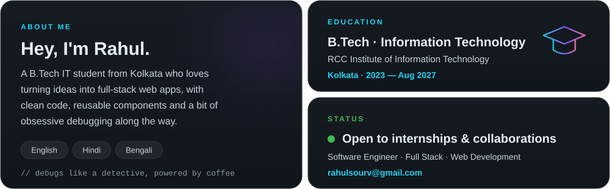

  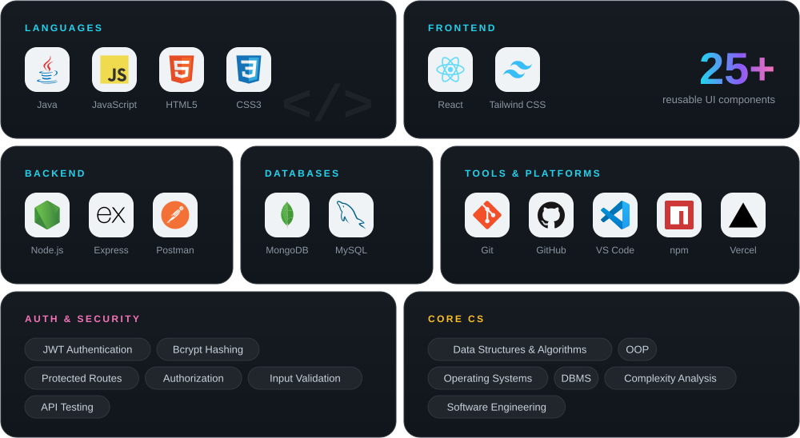

  <a href="https://github.com/rahulsourv/hexaglobalplacement">
    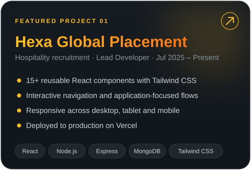
  </a>

  <a href="https://github.com/rahulsourv/Journal-App">
    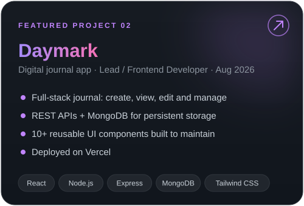
  </a>

  <a href="https://imeet-1.vercel.app/">
    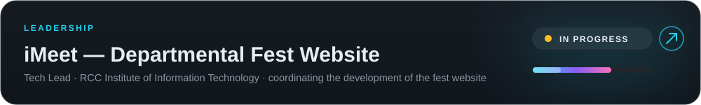
  </a>

  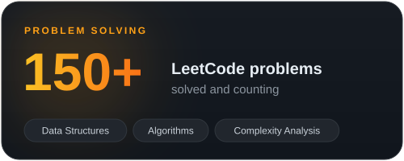

  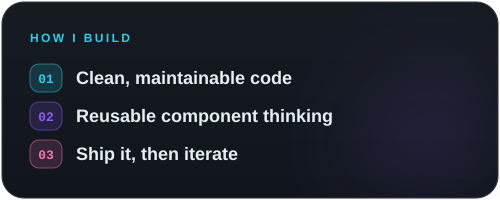

  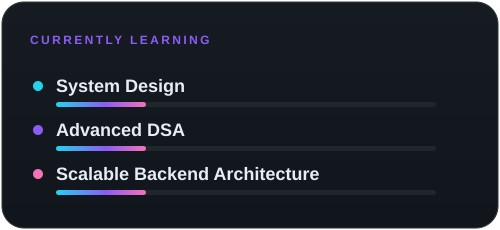

  

  <a href="https://linkedin.com/in/rahulsourv">
    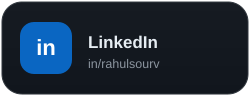
  </a>

  <a href="mailto:rahulsourv@gmail.com">
    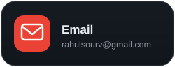
  </a>

  <a href="https://github.com/rahulsourv">
    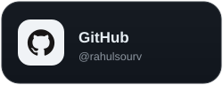
  </a>

  <a href="https://leetcode.com/u/YOUR-LEETCODE-USERNAME">
    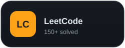
  </a>

  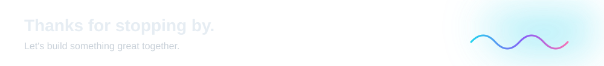

  

  

