<!--
  Bento-style GitHub profile README
  Every tile is a local SVG in /assets, so nothing depends on flaky third-party card servers.
  To edit text/colours, change the matching file in /assets.
-->

  
  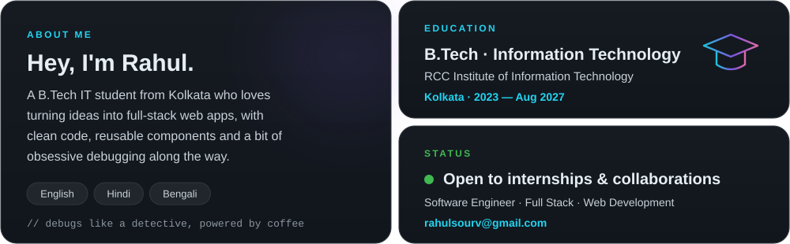
  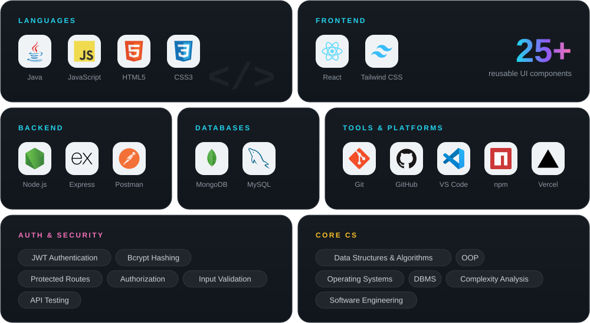
  <a href="https://github.com/rahulsourv/YOUR-HEXA-REPO">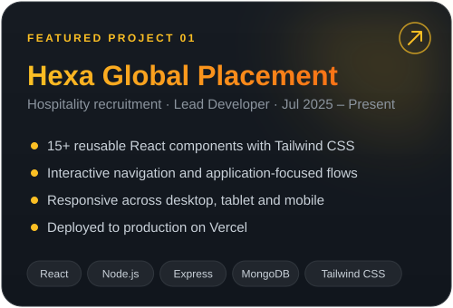</a>
  <a href="https://github.com/rahulsourv/YOUR-DAYMARK-REPO">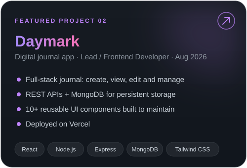</a>
  <a href="https://YOUR-IMEET-WEBSITE.com">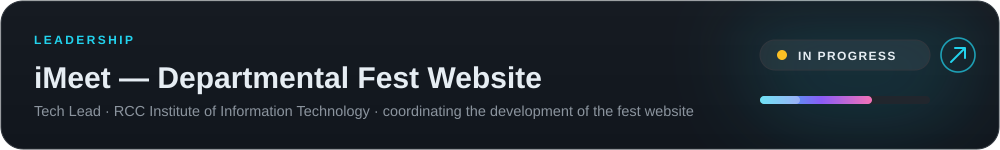</a>
  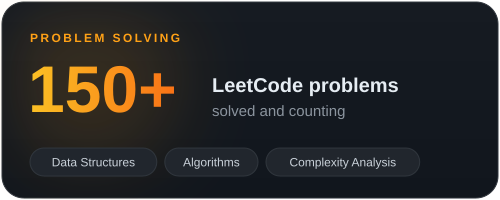
  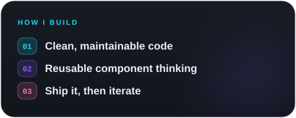
  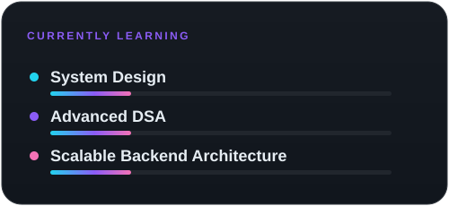
  
  <a href="https://linkedin.com/in/rahulsourv">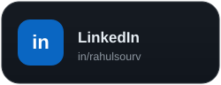</a>
  <a href="mailto:rahulsourv@gmail.com">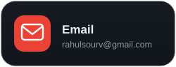</a>
  <a href="https://github.com/rahulsourv">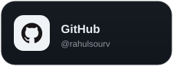</a>
  <a href="https://leetcode.com/u/YOUR-LEETCODE-USERNAME">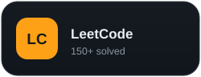</a>
  

  
  

